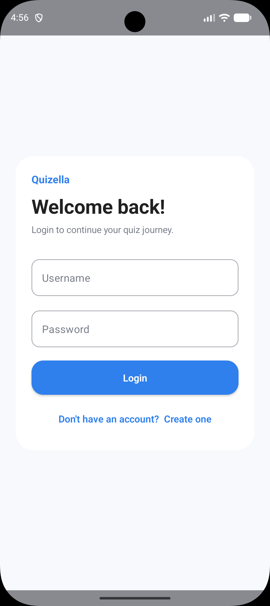
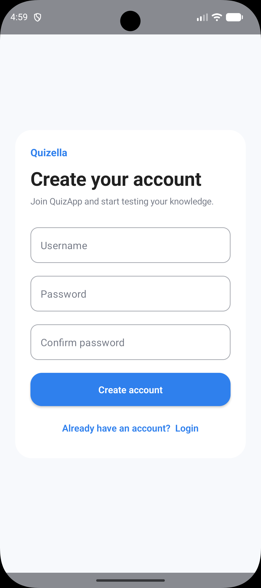
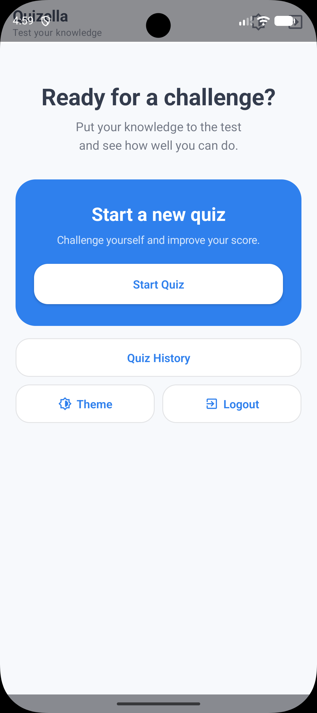
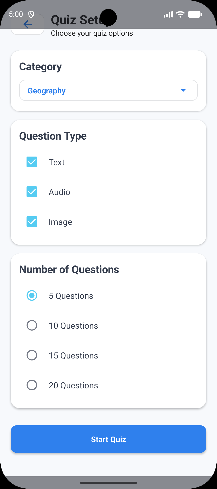
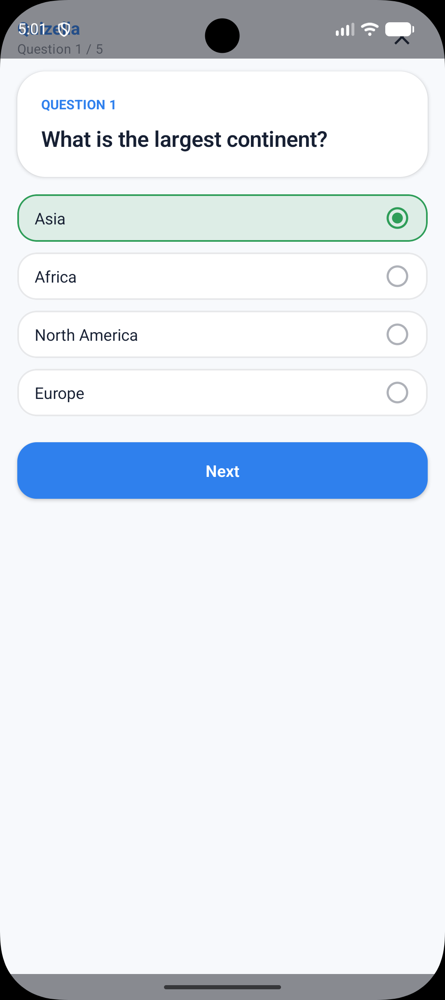
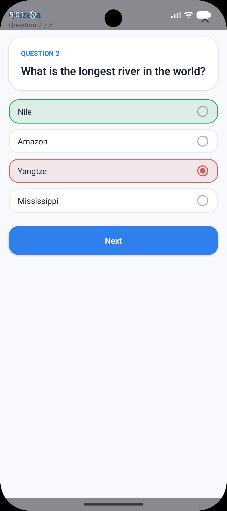
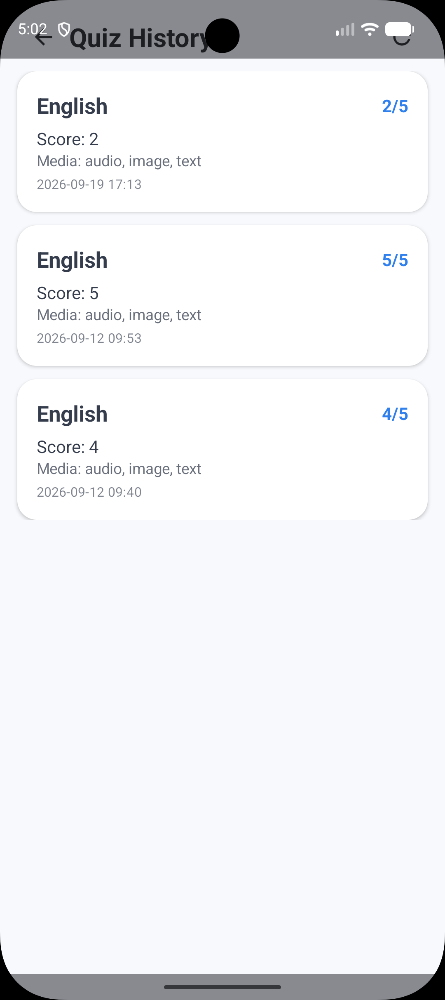

# QuizApp Android 🎯

QuizApp is an interactive Android quiz application that allows users to create and take customized quizzes, answer different types of questions, and review their previous quiz results.

The Android application was originally based on the open-source Quizella project and was significantly modified and extended to work with the project's custom backend API.

## ✨ Features

- 🔐 User registration and login
- 🔑 JWT authentication
- 🧠 Custom quiz configuration
- 📚 Category selection
- 📝 Text questions
- 🔊 Audio questions
- 🖼️ Image questions
- 🎯 Configurable question count
- ✅ Server-side answer validation
- 📊 Quiz score and results
- 📜 Quiz history
- 💾 Local question caching
- 🌐 REST API communication
- 🌓 Theme support
- 🧭 Compose Navigation
- 💉 Dependency Injection with Hilt
- 🧪 Unit and instrumentation test structure

## 📱 Screenshots

> Place the screenshots from the project archive in `docs/screenshots/`.

### Authentication

<p align="center">
  
  
</p>

### Main Screen & Quiz Setup

<p align="center">
  
  
</p>

### Quiz

<p align="center">
  
  
</p>

### Quiz History

<p align="center">
  
</p>

## 🏗️ Architecture

The application follows an **MVVM-based architecture** with separate data, domain, and presentation layers.

```text
┌─────────────────────────────┐
│        Presentation         │
│  Compose UI + ViewModels    │
└──────────────┬──────────────┘
               │
               ▼
┌─────────────────────────────┐
│           Domain            │
│ Models + Repository APIs    │
└──────────────┬──────────────┘
               │
               ▼
┌─────────────────────────────┐
│            Data             │
│ Repositories                │
│ ├── Remote API              │
│ └── Local Room Database     │
└──────────────┬──────────────┘
               │
        ┌──────┴──────┐
        ▼             ▼
   Backend API     Room DB
```

## 🛠️ Tech Stack

| Technology | Purpose |
|---|---|
| **Kotlin** | Android programming language |
| **Jetpack Compose** | Declarative UI |
| **MVVM** | Application architecture |
| **Hilt** | Dependency Injection |
| **Ktor Client** | HTTP networking |
| **Room** | Local database / cache |
| **DataStore** | Local preferences and authentication state |
| **Navigation Compose** | Screen navigation |
| **Kotlin Coroutines** | Asynchronous operations |
| **Material** | UI components |
| **JUnit** | Unit testing |
| **AndroidX Test** | Instrumentation testing |

## 🧩 Project Structure

```text
app/src/main/java/com/example/quizella/
│
├── common/
│   └── Constants.kt
│
├── data/
│   ├── data_source/
│   │   ├── local/
│   │   │   ├── Converters.kt
│   │   │   ├── QuestionCacheDao.kt
│   │   │   ├── QuestionsCacheDB.kt
│   │   │   └── UserDao.kt
│   │   │
│   │   └── remote/
│   │       ├── TriviaService.kt
│   │       └── dto/
│   │
│   └── repository/
│       ├── AuthRepositoryImpl.kt
│       ├── CategoriesRepositoryImpl.kt
│       ├── QuestionsRepositoryImpl.kt
│       ├── QuizResultRepositoryImpl.kt
│       └── ScoreRepositoryImpl.kt
│
├── domain/
│   ├── model/
│   │   ├── Category.kt
│   │   ├── Question.kt
│   │   ├── QuizConfig.kt
│   │   ├── QuizResult.kt
│   │   └── User.kt
│   │
│   └── repository/
│
├── di/
│   └── AppModule.kt
│
├── presentation/
│   ├── auth/
│   ├── finish/
│   ├── main/
│   ├── questions/
│   ├── quiz/
│   ├── results/
│   ├── common/
│   ├── theme/
│   └── util/
│
└── ui/
    └── theme/
```

## 🔄 Application Flow

```text
Register / Login
       │
       ▼
 Main Screen
       │
       ▼
  Quiz Setup
       │
       ├── Category
       ├── Question Type
       └── Question Count
       │
       ▼
     Quiz
       │
       ▼
Answer Validation
       │
       ▼
 Quiz Result
       │
       ▼
 Quiz History
```

## 🎮 Quiz Configuration

Before starting a quiz, users can configure:

### Category

Categories are retrieved from the backend and presented to the user for selection.

### Question Types

The application supports:

```text
Text
Audio
Image
```

Users can select the question/media types used in the quiz.

### Number of Questions

The quiz configuration allows the user to select the number of questions before starting.

## 🌐 Backend Communication

The Android application communicates with the QuizApp backend through `TriviaService`.

The API is used for:

```text
Authentication
Categories
Questions
Answer validation
Quiz results
Quiz history
```

The API base URL is configured in:

```text
common/Constants.kt
```

For the Android emulator, the backend running on the host machine can be accessed using:

```kotlin
const val API_BASE_URL = "http://10.0.2.2:8000"
```

For a physical device, replace the address with the local IP address of the machine running the backend.

## 🔐 Authentication

After login, the backend returns a JWT access token.

The Android application stores authentication state using **DataStore**.

Authenticated requests use:

```http
Authorization: Bearer <token>
```

When the user logs out, the locally stored authentication information is cleared.

## 💾 Local Data

The application uses **Room** for local question caching.

```text
Backend
   │
   ▼
TriviaService
   │
   ▼
QuestionsRepository
   │
   ▼
Room Database
   │
   ▼
ViewModel
   │
   ▼
Jetpack Compose UI
```

This keeps networking and persistence concerns separate from the UI.

## 🧠 Repository Layer

Repositories provide an abstraction between the presentation/domain layers and the data sources.

```text
QuestionsRepository
        │
        ▼
QuestionsRepositoryImpl
        │
   ┌────┴────┐
   ▼         ▼
TriviaService Room DAO
```

This structure makes the application easier to maintain and test.

## 💉 Dependency Injection

The project uses **Dagger Hilt** for dependency injection.

Hilt provides dependencies such as:

- HTTP client
- API service
- Room database
- DAOs
- Repositories
- ViewModels

Main configuration:

```text
di/AppModule.kt
```

## 🖥️ Main Screens

### Login

Allows existing users to authenticate.

### Register

Allows new users to create an account.

### Main Screen

Provides access to the main quiz functionality and user actions.

### Quiz Setup

Allows users to configure:

- Category
- Question/media types
- Number of questions

### Quiz

Displays questions and possible answers and communicates with the backend for answer validation.

### Results

Displays the result of the completed quiz.

### Quiz History

Displays previous quiz attempts, including information such as:

- Category
- Score
- Question count
- Question types
- Completion time

## 🎨 UI

The application uses **Jetpack Compose** and Material components.

The frontend was redesigned and extended from the original project with a new quiz flow and additional functionality.

The current UI includes:

- Card-based layouts
- Material buttons
- Radio buttons
- Checkboxes
- Dropdown selectors
- Loading indicators
- Theme support
- Compose-based responsive layouts

## 🧪 Testing

### Unit Tests

```text
app/src/test/
```

### Instrumentation Tests

```text
app/src/androidTest/
```

Run unit tests with:

```bash
./gradlew test
```

## ⚙️ Requirements

- Android Studio
- Android SDK
- Compatible JDK
- Android emulator or physical Android device

Current Android configuration:

```text
compileSdk: 33
minSdk: 24
targetSdk: 33
```

## 🚀 Setup

### 1. Clone the repository

```bash
git clone <YOUR_FRONTEND_REPOSITORY_URL>
cd Quizella
```

### 2. Configure the backend URL

Open:

```text
app/src/main/java/com/example/quizella/common/Constants.kt
```

Set the backend URL:

```kotlin
const val API_BASE_URL = "http://10.0.2.2:8000"
```

### 3. Start the backend

Make sure the QuizApp backend is running before launching the Android application.

### 4. Build and run

Open the project in Android Studio and run the `app` configuration.

## 🔗 Backend

This Android application is designed to work with the companion QuizApp backend:

```text
<YOUR_BACKEND_REPOSITORY_URL>
```

## 🎓 Project Context

QuizApp was originally based on an existing Android quiz application.

As part of this bachelor's degree project, the Android application was significantly modified and extended to communicate with a newly developed backend service.

The project work includes:

- Connecting the Android client to the custom backend
- Implementing authentication
- Implementing configurable quizzes
- Server-side answer validation
- Quiz result persistence
- Quiz history
- Text, image, and audio questions
- Local data persistence and caching
- UI and user-flow improvements

## 📄 License

This project contains code originally based on the Quizella project by Gautam Hazarika.

Please refer to the included `LICENSE.md` and repository history for applicable licensing information.


# 🧠 QuizApp
A quiz app based on MVVM architecture pattern to test your intelligence. Built using Android-Jetpack Compose and Ktor-client to retrieve data from server.

## Screenshots 📱 
Main | Questions | Finish 
--- | --- | --- 
 |  |  


## Build With 🛠

- [Kotlin](https://kotlinlang.org/) - First class and official programming language for Android
  development.
- [Jetpack Compose](https://developer.android.com/jetpack/compose) - Jetpack Compose is Android’s
  modern toolkit for building native UI.
- [Coroutines](https://kotlinlang.org/docs/reference/coroutines-overview.html) - A coroutine is a
  concurrency design pattern that you can use on Android to simplify code that executes
  asynchronously.
- [Flow](https://kotlinlang.org/docs/reference/coroutines/flow.html) - A flow is an asynchronous
  version of a Sequence, a type of collection whose values are lazily produced.
- [Android Architecture Components](https://developer.android.com/topic/libraries/architecture) -
  Collection of libraries that help you design robust, testable, and maintainable apps.
  - [Stateflow](https://developer.android.com/kotlin/flow/stateflow-and-sharedflow) - StateFlow is a
    state-holder observable flow that emits the current and new state updates to its collectors.
  - [Flow](https://kotlinlang.org/docs/reference/coroutines/flow.html) - A flow is an asynchronous
    version of a Sequence, a type of collection whose values are lazily produced.
  - [ViewModel](https://developer.android.com/topic/libraries/architecture/viewmodel) - Stores
    UI-related data that isn"t destroyed on UI changes.
  - [Jetpack Compose Navigation](https://developer.android.com/jetpack/compose/navigation) - The
    Navigation component provides support for Jetpack Compose applications.
  - [DataStore](https://developer.android.com/topic/libraries/architecture/datastore) - Jetpack
    DataStore is a data storage solution that allows you to store key-value pairs or typed objects
    with protocol buffers. DataStore uses Kotlin coroutines and Flow to store data asynchronously,
    consistently, and transactionally.
- [Ktor-client](https://medium.com/google-developer-experts/how-to-use-ktor-client-on-android-dcdeddc066b9) - Ktor includes a multiplatform asynchronous HTTP       client, which allows you to make requests and handle responses, extend its functionality with plugins, such as authentication, JSON serialization, and so on.
- [Dagger-Hilt](https://developer.android.com/training/dependency-injection/hilt-android) - Hilt is a dependency injection library for Android that reduces the     boilerplate of doing manual dependency injection in your project. Doing manual dependency injection requires you to construct every class and its                 dependencies by hand, and to use containers to reuse and manage dependencies.
- [Room](https://developer.android.com/training/data-storage/room) - The Room persistence library provides an abstraction layer over SQLite to allow fluent database access while harnessing the full power of SQLite.
- [Material Components for Android](https://github.com/material-components/material-components-android)
  - Modular and customizable Material Design UI components for Android.
- [Figma](https://figma.com/) - Figma is a vector graphics editor and prototyping tool which is
  primarily web-based.
  
  
## Back-end 🛰️
The app uses ktor-client to retrieve data from [The Trivia API](https://the-trivia-api.com/). For more information, read the [documentation](https://the-trivia-api.com/docs/v2/).

## Architecture 🗼

This app uses [***MVVM (Model View
View-Model)***](https://developer.android.com/jetpack/docs/guide#recommended-app-arch) architecture.

## Build-tool 🧰
You need to have [Android Studio Beta 3 or above](https://developer.android.com/studio/preview) to build this project.

## Contact 📩

Wanna reach out to me? DM me at 👇

Drop a mail to:- gautamhazarika01@gmail.com

## Donation 💰

If this project help you reduce time to develop, you can give me a cup of coffee :)

<a href="https://www.buymeacoffee.com/gautam.hz" target="_blank"></a>


## License 🔖

```

MIT License

Copyright (c) 2023 Gautam Hazarika

Permission is hereby granted, free of charge, to any person obtaining a copy
of this software and associated documentation files (the "Software"), to deal
in the Software without restriction, including without limitation the rights
to use, copy, modify, merge, publish, distribute, sublicense, and/or sell
copies of the Software, and to permit persons to whom the Software is
furnished to do so, subject to the following conditions:

The above copyright notice and this permission notice shall be included in all
copies or substantial portions of the Software.

THE SOFTWARE IS PROVIDED "AS IS", WITHOUT WARRANTY OF ANY KIND, EXPRESS OR
IMPLIED, INCLUDING BUT NOT LIMITED TO THE WARRANTIES OF MERCHANTABILITY,
FITNESS FOR A PARTICULAR PURPOSE AND NONINFRINGEMENT. IN NO EVENT SHALL THE
AUTHORS OR COPYRIGHT HOLDERS BE LIABLE FOR ANY CLAIM, DAMAGES OR OTHER
LIABILITY, WHETHER IN AN ACTION OF CONTRACT, TORT OR OTHERWISE, ARISING FROM,
OUT OF OR IN CONNECTION WITH THE SOFTWARE OR THE USE OR OTHER DEALINGS IN THE
SOFTWARE.


```

